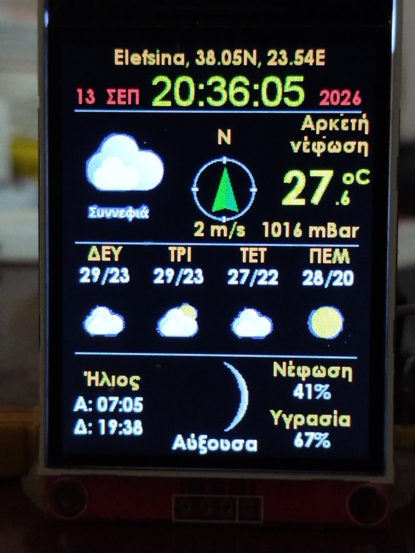

# ESP32-S3 OpenWeather Station (ILI9341)

A weather station for the **ESP32-S3** and a **240x320 ILI9341 SPI TFT**.
It shows the time, date, current weather, a 4 day forecast, sunrise/sunset, moon phase,
cloud cover and humidity from [OpenWeather](https://openweathermap.org/).
All settings are made in a **web dashboard**, no code changes needed.
The user interface is in **Greek** or **English**.

<p align="center">
  
</p>

Based on Bodmer's `TFT_eSPI_OpenWeather_LittleFS` example from the
[OpenWeather library](https://github.com/Bodmer/OpenWeather), which is based on the
original weather station by [Daniel Eichhorn (ThingPulse / Squix)](https://blog.squix.org).

---

## Features

- Location with coordinates, large clock with seconds, date and year
- Current conditions: 100x100 icon, short group name, two line description,
  temperature with one decimal, wind direction compass, wind speed and pressure
- 4 day forecast: day name, max/min temperature and icon
- Sunrise and sunset, moon phase image and name, cloud cover and humidity
- Day and night icons, chosen from the sunrise and sunset times
- Time from NTP with automatic daylight saving
- **Web dashboard** (`http://weather.local/`): WiFi, API key, location, units, language,
  time zone, rotation and update interval, status and "refresh now"
- **Setup access point** with captive portal on first boot or when WiFi fails
- Greek or English display and dashboard
- **OTA updates** over WiFi from the browser or the Arduino IDE, with automatic rollback
- Free anti-aliased fonts (Noto Sans, SIL Open Font License) with Greek characters
- Optional: values from a ThingSpeak channel (tank monitor), disabled by default

## Hardware

| Part      | Tested with                                                    |
|-----------|----------------------------------------------------------------|
| MCU       | ESP32-S3 N16R8 (16MB flash, 8MB octal PSRAM), CH343 USB-UART   |
| Display   | ILI9341 2.4"/2.8" 240x320 SPI TFT                              |

### Wiring

| TFT pin       | ESP32-S3 GPIO | Note                                       |
|---------------|---------------|--------------------------------------------|
| SDI (MOSI)    | 3             |                                            |
| SCK           | 4             |                                            |
| CS            | 1             |                                            |
| DC / RS       | 10            |                                            |
| RESET         | 0             | GPIO0 is the BOOT pin, see Troubleshooting |
| SDO (MISO)    | -             | Not connected                              |
| LED           | 3.3V          | Backlight always on                        |
| VCC / GND     | 3.3V / GND    |                                            |

Do not use GPIO 26-32 (SPI flash/PSRAM) or GPIO 33-37 on octal PSRAM modules.
GPIO 19/20 are the native USB pins.

## Software

### Arduino IDE and board package

- Arduino IDE 2.x (or arduino-cli)
- **esp32** board package by Espressif, version 3.x (tested with 3.3.10)

### Libraries

| Library            | Source                                                            |
|--------------------|-------------------------------------------------------------------|
| TFT_eSPI           | Library Manager (tested 2.5.43)                                   |
| OpenWeather        | https://github.com/Bodmer/OpenWeather (download ZIP)              |
| JSON_Decoder       | https://github.com/Bodmer/JSON_Decoder (download ZIP, **not** the Library Manager "JSON Decoder") |
| TJpg_Decoder       | Library Manager (tested 1.1.0)                                    |
| Time               | Library Manager, by Michael Margolis / Paul Stoffregen (1.6.1)    |
| Timezone           | Library Manager, by Jack Christensen                              |
| FlickerFreePrint   | https://github.com/KrisKasprzak/FlickerFreePrint                  |
| ThingSpeak         | Library Manager, by MathWorks                                     |

LittleFS, WebServer, DNSServer, ESPmDNS and Preferences are part of the ESP32 core.

### TFT_eSPI display setup

TFT_eSPI takes its pins from its own setup files, not from the sketch.

1. Copy `extras/Setup_ESP32S3_ILI9341_Weather.h` to
   `Documents/Arduino/libraries/TFT_eSPI/User_Setups/`.
2. In `TFT_eSPI/User_Setup_Select.h`, comment out `#include <User_Setup.h>` and add:
   ```cpp
   #include <User_Setups/Setup_ESP32S3_ILI9341_Weather.h>
   ```

This change applies to every sketch that uses TFT_eSPI. Switch it back for other projects.

## Installation

1. **Clone or download** this repository. The folder name must stay
   `ESP32_ILI9341_openweathermap_16` (same as the `.ino` file).
2. **Get an OpenWeather API key:** [free account](https://home.openweathermap.org/users/sign_up),
   then *My API keys*. New keys can take up to 2 hours to become active.
3. **Board settings** (Tools menu):

   | Option           | Value                                                   |
   |------------------|---------------------------------------------------------|
   | Board            | ESP32S3 Dev Module                                      |
   | USB CDC On Boot  | Disabled (USB-UART chip) / Enabled (native USB)         |
   | Flash Size       | Your module's size (e.g. 16MB)                          |
   | Partition Scheme | `8M with spiffs (3MB APP/1.5MB SPIFFS)` (needs 8MB+ flash) |
   | PSRAM            | OPI PSRAM (N8R8/N16R8), else Disabled                   |

   On a 4MB module use `Default 4MB with spiffs (1.2MB APP/1.5MB SPIFFS)`; if the
   sketch is then too big, use `No OTA (2MB APP/2MB SPIFFS)`.
4. **Upload the sketch.**
5. **Upload the data folder to LittleFS** (fonts, icons, moon and wind images).
   Do this again whenever you change the partition scheme.
   Without this step the board stops with `Αποτυχία αρχικοποίησης Flash FS!`.

### Uploading the data folder

**Arduino IDE 2.x:** install the
[arduino-littlefs-upload](https://github.com/earlephilhower/arduino-littlefs-upload)
plugin, close the Serial Monitor, then press `Ctrl+Shift+P` and run
**Upload LittleFS to Pico/ESP8266/ESP32**. It uses the partition scheme selected in the IDE.

**Command line:** build the image with the size of the `spiffs` partition and write it
at its offset. For `8M with spiffs` that is offset `0x670000`, size `0x180000`;
for `Default 4MB with spiffs` offset `0x290000`, size `0x160000`.

```bash
mklittlefs -c data -b 4096 -p 256 -s 0x180000 littlefs.bin
```

```bash
esptool --chip esp32s3 --port COM10 --baud 921600 write-flash 0x670000 littlefs.bin
```

Both tools are in `Arduino15/packages/esp32/tools/`. The offsets of every scheme are in
`Arduino15/packages/esp32/hardware/esp32/<version>/tools/partitions/*.csv`.

## First start and the web dashboard

1. On first boot (no WiFi saved) the display shows **Setup** with a WiFi name like
   `WeatherStation-A1B2`, its password (`weather123`) and the address `http://192.168.4.1`.
2. Connect a phone or PC to that WiFi. The settings page opens by itself (captive portal),
   otherwise open `http://192.168.4.1`.
3. Choose your home WiFi (**Scan** lists nearby networks), enter the password, the
   OpenWeather API key and your location, then **Save and restart**.
4. The station connects to your WiFi and shows the dashboard address at the bottom of the
   boot screen. Open `http://<that ip>/` or `http://weather.local/` at any time to change
   the settings.

| Dashboard setting          | Description                                                  |
|----------------------------|--------------------------------------------------------------|
| WiFi name / password       | Home network (2.4 GHz only)                                  |
| OpenWeather API key        | 32 character key                                             |
| Latitude / longitude       | Forecast location, decimal degrees                           |
| Units                      | Metric (°C, m/s, mBar) or imperial (°F, mph, in)             |
| Update every               | Weather download interval, 5-180 minutes (free plan: up to 1000 calls/day) |
| Description language       | `en` = the station's own Greek/English texts; `el`, `de`, `fr`... = OpenWeather translation |
| Language                   | Display and dashboard language: Ελληνικά / English          |
| Rotation                   | Normal or upside down                                        |
| Time zone                  | Eastern/Central Europe, UK, US zones, Australia Eastern      |
| Dashboard password         | Optional, HTTP Basic auth with user `admin`. Also enables OTA updates |

Other buttons: **Refresh weather now**, **Firmware update** (see below),
**Factory reset** (deletes all settings and starts the setup access point again).

If the saved WiFi is not reachable at boot (e.g. router off), the setup access point
starts and the station retries the saved WiFi every 5 minutes.

Settings are stored in flash (NVS) and are kept when you upload a new sketch.

> **Security:** the dashboard uses plain HTTP and is meant for your home network only.
> Do not forward it to the internet. Set a dashboard password if other people use your
> network. Saved passwords and the API key are never sent back to the browser.

## Updating over WiFi (OTA)

OTA updates are enabled when a **dashboard password** is set (dashboard, section
*Dashboard password*). The same password protects the updates. Settings are kept.
The first OTA capable firmware has to be uploaded once over USB.

**From the Arduino IDE:** select the network port **weather at 192.168.x.x** in
*Tools → Port* and click Upload. The IDE asks for the dashboard password.

**From the browser:**

1. In the Arduino IDE use *Sketch → Export Compiled Binary*.
2. Open `http://weather.local/update` (or the *Firmware update* card in the dashboard).
3. Choose `build/esp32.esp32.esp32s3/ESP32_ILI9341_openweathermap_16.ino.bin`
   (not `.merged.bin` or `.bootloader.bin`) and press **Upload firmware**.

The data folder (fonts, icons) can be updated the same way with a LittleFS image,
**Upload files**. Build the image at the size of the LittleFS partition, for
`8M with spiffs`:

```bash
mklittlefs -c data -b 4096 -p 256 -s 0x180000 littlefs.bin
```

The display shows the progress and the station restarts when done.
If the new firmware crashes before it connects to the network, the bootloader
automatically starts the previous firmware again.

### Optional build time defaults

Instead of typing WiFi and API key in the dashboard you can build them in: copy
`secrets_example.h` to `secrets.h` and fill it in. These values are used until settings
are saved in the dashboard. `secrets.h` is in `.gitignore`.

Other defaults (location, language, time zone, setup AP password, hostname) are at the
top of `All_Settings.h`.

## Fonts

The fonts in `data/fonts` are made from [Noto Sans](https://fonts.google.com/noto)
(SIL Open Font License 1.1, see `extras/fonts/OFL.txt`) and contain Latin and Greek:

| File               | Font               | Used for        |
|--------------------|--------------------|-----------------|
| NotoSansBold15.vlw | Noto Sans Bold 15  | Most text       |
| NotoSansBold36.vlw | Noto Sans Bold 36  | Temperature     |
| NotoSans30.vlw     | Noto Sans Regular 30 | Clock         |

To make other sizes or fonts (Python 3 with Pillow):

```bash
python extras/fonts/mkvlw.py NotoSans-Bold.ttf 15 data/fonts/NotoSansBold15.vlw "Noto Sans Bold" "NotoSans-Bold"
```

Then change the `AA_FONT_*` names at the top of the `.ino`.

## Optional features

At the top of the `.ino`:

| Define             | Effect                                                         |
|--------------------|----------------------------------------------------------------|
| `SERIAL_MESSAGES`  | Prints the full forecast to the Serial Monitor (115200 baud)   |
| `RANDOM_LOCATION`  | Test only: random location on every refresh                    |
| `FORMAT_LittleFS`  | Erases LittleFS on boot, disable again afterwards!             |

## Project structure

```
ESP32_ILI9341_openweathermap_16/
├── ESP32_ILI9341_openweathermap_16.ino  Main sketch: setup, loop, all drawing
├── All_Settings.h                       First boot defaults, fixed settings, display texts
├── WebConfig.h                          Settings, setup access point, web server, OTA
├── Dashboard.h                          HTML pages: dashboard and update page
├── secrets_example.h                    Template for optional build time defaults
├── NTP_Time.h                           NTP time sync and time zone rules
├── GfxUi.h / GfxUi.cpp                  BMP drawing and progress bar
├── MoonPhase.ino                        Moon phase calculation
├── data/                                Upload to LittleFS
│   ├── fonts/                           Noto Sans fonts (.vlw)
│   ├── icon/                            100x100 weather icons
│   ├── icon50/                          50x50 forecast icons
│   ├── moon/                            Moon phase images
│   └── wind/                            Wind direction compass images
├── extras/
│   ├── Setup_ESP32S3_ILI9341_Weather.h  TFT_eSPI pin setup
│   └── fonts/                           Font converter (mkvlw.py) and font license
└── docs/
    └── display.jpg                      Photo for this README
```

Optional splash images can be added as `data/splash/OpenWeather.jpg` and
`data/splash/Elefsina.jpg`; they are skipped if missing.

## Troubleshooting

| Symptom | Cause / fix |
|---------|-------------|
| `Αποτυχία αρχικοποίησης Flash FS!` or `mount failed (-84)` | The data folder was not uploaded, or the partition scheme changed after the upload. Upload the data folder again. |
| "Sketch too big" | Choose a partition scheme with a bigger APP, then upload the data folder again. |
| Setup screen appears every boot | The saved WiFi is wrong or out of range. Enter it again in the setup page. 5 GHz networks are not supported. |
| `weather.local` does not open | Some Android phones do not support mDNS, use the IP address shown on the boot screen. |
| Weather does not load, last update ✗ | Wrong or not yet active API key (new keys take up to 2 hours). |
| White or black screen | Wrong TFT_eSPI setup selected, or wrong wiring. Check `User_Setup_Select.h`. |
| Board does not start after power on, starts after reset | GPIO0 (TFT RESET) is a boot strapping pin. Move RESET to a free GPIO, or set `TFT_RST -1` and wire it to the board's EN pin. |
| Crash in `TFT_eSPI::begin()` | Keep `#define USE_HSPI_PORT` in the TFT_eSPI setup file. |
| `fatal error: tjpgd.h` / `TimeLib.h` / `JSON_Decoder.h` missing | Incomplete library install. Remove the library and install it again. |
| Port busy during upload | Close the Serial Monitor first. |
| No "weather" network port in the IDE | Set a dashboard password (OTA is off without it), check that the PC is on the same network, restart the IDE. |
| Browser update fails with "Not authorised" | Reload the update page and enter the dashboard password (user `admin`). |
| No compass under the wind letter | `data/wind/*.bmp` missing in LittleFS. |

## Credits

- **Daniel Eichhorn** ([ThingPulse / Squix](https://blog.squix.org)): original weather station
- **Bodmer**: [OpenWeather](https://github.com/Bodmer/OpenWeather),
  [TFT_eSPI](https://github.com/Bodmer/TFT_eSPI),
  [JSON_Decoder](https://github.com/Bodmer/JSON_Decoder),
  [TJpg_Decoder](https://github.com/Bodmer/TJpg_Decoder), icons, wind and moon images,
  moon phase code
- **The Noto Project Authors**: Noto Sans fonts
- **ManosMar**: ESP32-S3 port, web dashboard, Greek/English user interface, layout and fixes
- Weather data: [OpenWeather](https://openweathermap.org/)

## License

MIT, see [LICENSE](LICENSE). Parts by Bodmer are under the FreeBSD license.
The Noto Sans fonts are under the SIL Open Font License 1.1 (`extras/fonts/OFL.txt`).
